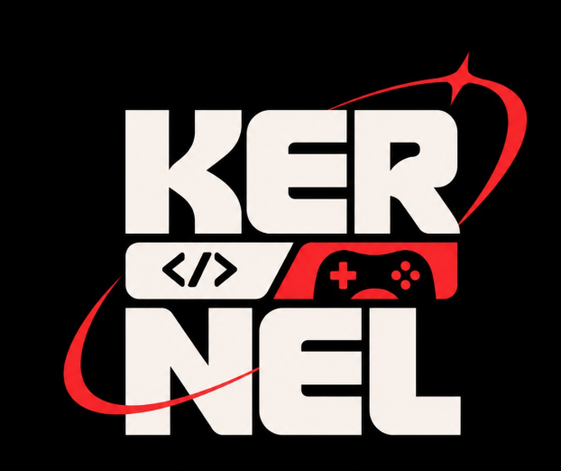

<div align="center">


&nbsp;&nbsp;&nbsp;&nbsp;


# KERNEL 1.0

### Flagship Tech Fest Hackathon · Department of Information Technology, Jadavpur University

[](https://nextjs.org/)
[](https://react.dev/)
[](https://www.typescriptlang.org/)
[](https://tailwindcss.com/)

[🎨 Open the website design prototype reference](https://illumine-reunion-ju-it.github.io/Kernel-2026/design.html)

</div>

---

## 🎨 Color Palette & Design Tokens

Extracted from the design specification and configured as custom CSS variables and Tailwind theme tokens:

| Color Token | Name | Hex / Value | Usage |
|---|---|---|---|
| `bg` / `forest` | Forest green | `#0B241A` | Primary canvas background |
| `panel` | Panel green | `#123729` | Container cards & content panels |
| `panel2` | Dark panel | `#183F30` | Secondary cards & hover states |
| `sand` / `brand-beige` | Sand beige | `#E9DFC5` | Primary brand accent & highlights |
| `ink` | Light cream | `#EEE5D0` | Primary text foreground |
| `muted` | Muted sand | `#B6B39F` | Secondary text & subtitles |
| `purple` | Electric purple | `#9A4DFF` | Accent highlights & gradients |
| `mint` | Lavender mint | `#B77CFF` | Interactive links & focus outlines |
| `red` | Logo red | `#FF2D2D` | Live status indicators & badges |
| `black` | Deep black | `#050505` | University bar & footer backgrounds |
| `line` | Border line | `rgba(233, 223, 197, 0.17)` | Structural dividers & card borders |

---

## 🚀 Getting Started

### Prerequisites

- **Node.js**: `v18.18.0` or higher (`v20.x` or `v24.x` recommended)
- **npm**: `v9.0.0` or higher (`v10.x` / `v11.x` supported)

### Installation

Clone the repository and install dependencies:

```bash
npm install
```

### Development

Run the local development server:

```bash
npm run dev
```

Open [http://localhost:3000](http://localhost:3000) in your browser to view the application.

### Type Checking

Verify TypeScript types across the project:

```bash
npm run typecheck
```

### Code Quality & Linting

Run ESLint to check for code quality and style guidelines:

```bash
npm run lint
```

### Production Build

Create an optimized production build:

```bash
npm run build
```

Run the production server locally after building:

```bash
npm run start
```

---

## ⚙️ Environment Configuration

The application foundation is fully functional out of the box and does not require private API keys, secrets, or database credentials for local development.

Refer to [`.env.example`](.env.example) for available configuration options:

```bash
# Optional public site URL for metadata generation
NEXT_PUBLIC_SITE_URL=http://localhost:3000
```

---

## 📁 Repository Architecture & Directory Guide

```text
kernel-2026/
├── app/                  # Next.js App Router routes, layouts, metadata, and globals.css
├── components/           # Reusable UI primitives, layout wrappers, and feature sections
│   ├── ui/               # Base components (buttons, containers, badges, headings)
│   ├── navigation/       # Navbar, footer, and mobile navigation components
│   └── [feature]/        # Feature-specific components (home, events, speakers, etc.)
├── data/                 # Organiser-editable JSON content models
├── docs/                 # Contributor guidelines, documentation, and checklists
├── lib/                  # Shared utilities, metadata helpers, and content fetchers
├── public/               # Static assets, rulebook PDFs, and image directories
│   ├── docs/             # Public PDFs, brochures, and rulebooks
│   └── images/           # Event-owned imagery and graphics
├── types/                # TypeScript interfaces and data contracts
├── design.html           # Single-file visual reference prototype (do NOT use as production app)
├── components.json       # shadcn/ui configuration
├── next.config.ts        # Next.js configuration
├── tailwind.config.ts    # Tailwind CSS configuration with design tokens
├── postcss.config.mjs    # PostCSS configuration
├── tsconfig.json         # TypeScript strict configuration
└── package.json          # Dependencies, scripts, and package metadata
```

### Directory Roles & Scopes

- **`app/`**: Contains the Next.js App Router root layout (`layout.tsx`), root page (`page.tsx`), and global styles (`globals.css`). Defines all application routes, metadata, and server-side rendering logic.
- **`components/`**: Houses modular React components. Built with Tailwind CSS and designed for accessibility, responsiveness, and reusability across pages.
- **`public/`**: Stores public static assets served directly at the root URL (e.g. `public/images/`, `public/docs/`).
- **`design.html`**: A standalone HTML/CSS prototype preserved exclusively as a visual reference for layout, colors, and typography. It is not embedded or used as the production website.

---

## 🛣️ Website Roadmap & Issue Backlog

The platform is structured into modular GitHub issues:

1. **Issue #1 (Completed)**: Project foundation, Next.js setup & frontend architecture
2. **Issue #2**: Design system components, typography & utility tokens
3. **Issue #3**: Layout structure, header navbar, footer & 404 page
4. **Issue #4**: Home page implementation & interactive sections
5. **Issue #5**: Events showcase & dynamic event detail routes
6. **Issue #6**: Speakers directory & speaker profiles
7. **Issue #7**: Sponsors showcase & core organizing committee
8. **Issue #8**: Contact page, registration info & interactive FAQ
9. **Issue #9**: Privacy policy, code of conduct & legal pages
10. **Issue #10**: Motion design, micro-interactions & responsive polish
11. **Issue #11**: SEO metadata, OpenGraph cards & sitemap generation
12. **Issue #12**: CI/CD automation & linting pipelines
13. **Issue #13**: Content auditing, cross-browser QA & production release

> **Scope Notice**: Authentication, payment gateways, checkout systems, merchandise handling, and database write operations are deliberately out of scope for this static/SSR event platform.
